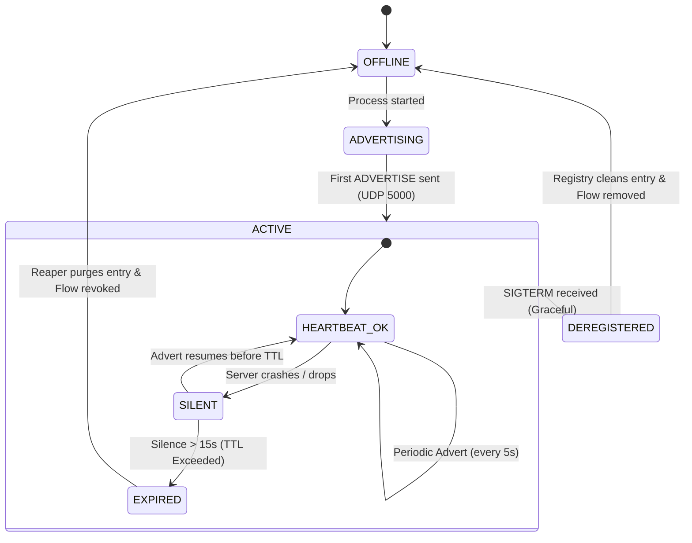

# Architecture & Problem Understanding — Service Discovery SDN

## 1. Problem Definition & Objectives
In modern dynamic networks and microservice environments, clients should not require hardcoded knowledge of where services run. In this system:
1. **Servers announce themselves autonomously** by sending periodic UDP advertisements.
2. A **registry** maintains the active directory of live services, tracking heartbeat TTLs.
3. **Clients perform on-demand discovery** via lightweight UDP query-reply messages with client-side retransmission and latency measurement.
4. An **SDN Controller (OS-Ken on OpenFlow 1.3 / Open vSwitch)** applies data-plane rules. The controller accepts unauthenticated UDP advertisements; an advertisement can trigger a line-rate `ALLOW` flow but does not authenticate the server. If a server crashes or goes silent, the flow rule is intended to be revoked. Verify installation/removal against live OVS state during a demonstration.
5. The Web GUI and REST API follow the selected runtime: standalone uses **GUI → host backend → host registry/services**. In Mininet mode, the GUI/backend is **not bridged into Mininet namespaces**; the Mininet/OVS demonstration is performed through the Mininet CLI path.

---

## 2. End-to-End System Pipeline

```text
                        USER (Web Browser)
                                 |
                                 v
                 +-------------------------------+
                 |       NOC Control GUI         |  (HTML5, CSS3, WebSockets)
                 +---------------+---------------+
                                 |
                         HTTP / WS (:8000)
                                 |
                                 v
                 +-------------------------------+
                 |        FastAPI Backend        |  (Async Event Bus, Process Manager,
                 +---------------+---------------+   Flow Inspector, Test Suite)
                                 |
        +------------------------+------------------------+
        |                                                 |
        v (Low-level UDP queries)                         v (Subprocess management /
+---------------+                                 +---------------+  live socket events)
|    Client     |                                 | Service Server|
| (src/client)  |                                 |(src/service_s)|
+-------+-------+                                 +-------+-------+
        |                                                 |
        | UDP:5001 (DISCOVER / REPLY)                     | UDP:5000 (ADVERTISE / DEREGISTER)
        |                                                 | UDP:7000 (Service Echo)
        v                                                 v
+---------------+---------------------------------+---------------+
|                                                                 |
|                  Service Registry (src/registry)                |
|                  Port 5000: Advertisements                      |
|                  Port 5001: Queries                             |
|                  Reaper Thread: 15s TTL Heartbeat Timeout       |
|                                                                 |
+-------------------------------+---------------------------------+
                                |
                                v
                +-------------------------------+
                | Open vSwitch / Mininet (sw1)  |
                +---------------+---------------+
                                |
                          OpenFlow 1.3
                                |
                                v
                +-------------------------------+
                | SDN Controller (OS-Ken App)   |  (Prio 300, 250, 200, 1, 0)
                +-------------------------------+
```

---

## 3. Communication Flow & Sequence

The following sequence illustrates the intended Mininet/OVS network interactions; it does not mean the host GUI/backend is connected to Mininet namespaces. Perform the Mininet/OVS demonstration through the Mininet CLI path. Verify FlowMods with live `ovs-ofctl` output; standalone registry events do not prove that a switch flow was installed.

```mermaid
sequenceDiagram
    autonumber
    participant GUI as Web GUI
    participant API as FastAPI Backend
    participant Client as Client Socket
    participant SW as Switch (sw1)
    participant Ctrl as SDN Controller
    participant Reg as Registry
    participant Server as Service Server

    Note over SW,Ctrl: Initial OpenFlow handshake: Controller installs Miss (0), Default-Deny (200), Snoop (250)
    Server->>SW: UDP ADVERTISE (dst: 5000, "chat", port: 7000, ttl: 15)
    SW->>Ctrl: PacketIn (Priority 250 Snoop Rule)
    Ctrl->>SW: FlowMod (Priority 300 ALLOW udp dst=7000 to Server IP)
    Ctrl->>SW: PacketOut (forward advert to Registry)
    SW->>Reg: Forward UDP ADVERTISE
    Reg->>Reg: Update Table & Reset TTL
    API->>GUI: Registry state event; standalone mode marks expected SDN policy unverified

    GUI->>API: POST /api/discover {"service": "chat", "use": true}
    API->>Client: run_discover()
    Client->>Reg: UDP DISCOVER "chat" (dst: 5001, req_id: 4a2b1c)
    Reg->>Client: UDP REPLY [srv1@10.0.0.1:7000] (latency: 0.45ms)
    API->>GUI: WebSocket Push: CLIENT/DISCOVERY_RESULT
    
    Client->>SW: UDP Echo Request to srv1:7000
    Note over SW: Matched Priority 300 ALLOW rule!
    SW->>Server: Deliver Datagram
    Server->>Client: UDP Echo Response "srv1[chat] says: hello"
    API->>GUI: WebSocket Push: SERVER/RESPONSE_RECEIVED + HTTP Response

    Note over Server: Server crashes (SIGKILL) - Heartbeat silence
    Note over Reg: 15 seconds pass without advert
    Reg->>Reg: Reaper thread purges srv1
    API->>GUI: WebSocket Push: REGISTRY/EXPIRED
    Ctrl->>SW: FlowMod DELETE Priority 300 ALLOW rule
    API->>GUI: Registry expiry event; OpenFlow removal requires live switch inspection

    Client->>SW: Subsequent call to srv1:7000
    Note over SW: Priority 200 DEFAULT DENY matches!
    SW--xClient: PACKET DROPPED (Silent Drop)
    Client->>API: Timeout after retries
    API->>GUI: HTTP/WS: Service Unavailable (default-deny flow matched)
```

---

## 4. OpenFlow 1.3 Flow Table Design

The data plane on switch `sw1` uses a strict 5-tier priority hierarchy:

```text
Priority 300: ALLOW ADVERTISED SERVICE (advertisement is unauthenticated)
       │     (Match: udp, nw_dst=<server_ip>, tp_dst=7000 -> Action: output:port)
       ▼
Priority 250: ADVERTISEMENT SNOOPING
       │     (Match: udp, tp_dst=5000 -> Action: CONTROLLER:65535)
       ▼
Priority 200: DEFAULT DENY (UDP service traffic without a higher-priority allow flow)
       │     (Match: udp, tp_dst=7000 -> Action: drop)
       ▼
Priority 1:   NORMAL L2 FORWARDING
       │     (Match: in_port=*, eth_dst=* -> Action: output:port learned)
       ▼
Priority 0:   TABLE MISS
             (Match: * -> Action: CONTROLLER:65535)
```

### Detailed Flow Specifications

| Priority | Match Criteria | Actions | Trigger / Installed When | Lifecycle & Removal |
|---|---|---|---|---|
| **300** | `udp, nw_dst=<ip>, tp_dst=7000` | `output:<port>` | Dynamic: on valid `ADVERTISE` | Removed on `DEREGISTER` or 15s TTL silence |
| **250** | `udp, tp_dst=5000` | `CONTROLLER` | Static: switch connection | Permanent (Switch lifetime) |
| **200** | `udp, tp_dst=7000` | `drop` | Static: switch connection | Permanent unless replaced by a higher-priority matching allow flow |
| **1** | `in_port=X, eth_dst=Y` | `output:Y` | Dynamic: MAC learning | Learns unicast MAC paths; idle timeout |
| **0** | `(any)` | `CONTROLLER` | Static: switch connection | Base OpenFlow fallback |

---

## 5. Application Messages (Wire Format)

All discovery and control messages are transmitted as UTF-8 encoded JSON datagrams over UDP:

### 1. `ADVERTISE` (Server → Registry / SDN Snoop :5000)
```json
{
  "type": "ADVERTISE",
  "name": "srv1",
  "service": "chat",
  "port": 7000,
  "ttl": 15.0
}
```

### 2. `DEREGISTER` (Server → Registry / SDN Snoop :5000)
```json
{
  "type": "DEREGISTER",
  "name": "srv1",
  "service": "chat"
}
```

### 3. `DISCOVER` (Client → Registry :5001)
```json
{
  "type": "DISCOVER",
  "service": "chat",
  "req_id": "a1b2c3d4"
}
```

### 4. `REPLY` (Registry → Client :5001)
```json
{
  "type": "REPLY",
  "req_id": "a1b2c3d4",
  "service": "chat",
  "count": 2,
  "servers": [
    {"name": "srv1", "service": "chat", "ip": "10.0.0.1", "port": 7000, "age": 1.2},
    {"name": "srv2", "service": "chat", "ip": "10.0.0.2", "port": 7000, "age": 3.8}
  ]
}
```

---

## 6. Failure Recovery & Robustness State Machine



---

## 7. Performance Evaluation & Baseline Comparison

### Measured Round-Trip Metrics

No benchmark measurements are checked into this repository as verified results. Use the dashboard or `POST /api/performance/run` to execute repeated live UDP discovery and service-call trials. Each run saves timestamped raw JSON under `docs/evidence/benchmark-<UTC timestamp>.json`, including successes, failures, endpoint, and per-trial latency. Summary statistics include min, max, mean, median, population standard deviation, and p95. Failure detection and OpenFlow removal are not measured by this endpoint and must be recorded during a Mininet experiment.

The static-versus-dynamic comparison below is qualitative. It does not claim zero-millisecond static lookup, a TCP keepalive time, or measured SDN convergence. A quantitative comparison needs a configured static endpoint and equivalent trials in the same environment.

### Technical Architectural Comparison

| Dimension | Static Baseline Approach | Dynamic Socket + SDN (This Project) |
|---|---|---|
| **Configuration Model** | Manual static IP tables or DNS records | Fully autonomous self-registration |
| **Data Plane Policy** | Broad subnet allowance or static ACLs | Default-deny with advertisement-triggered allow flows; advertisements are unauthenticated |
| **Failure Convergence** | Endpoint updates are manual unless another mechanism is used | Registry TTL expiry and controller flow revocation (requires live Mininet/OVS verification) |
| **Rogue Endpoint Handling** | Requires manually maintained policy | Priority 200 default-deny policy (requires live Mininet/OVS verification); advertisements are not authenticated |
| **Network Reconfiguration** | Requires network operator intervention | Autonomous OpenFlow FlowMod events |
